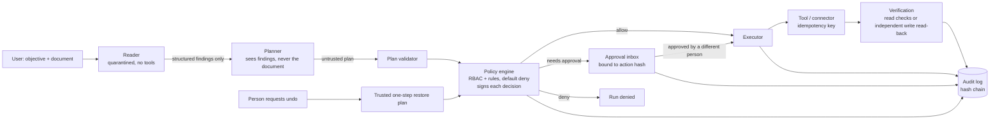
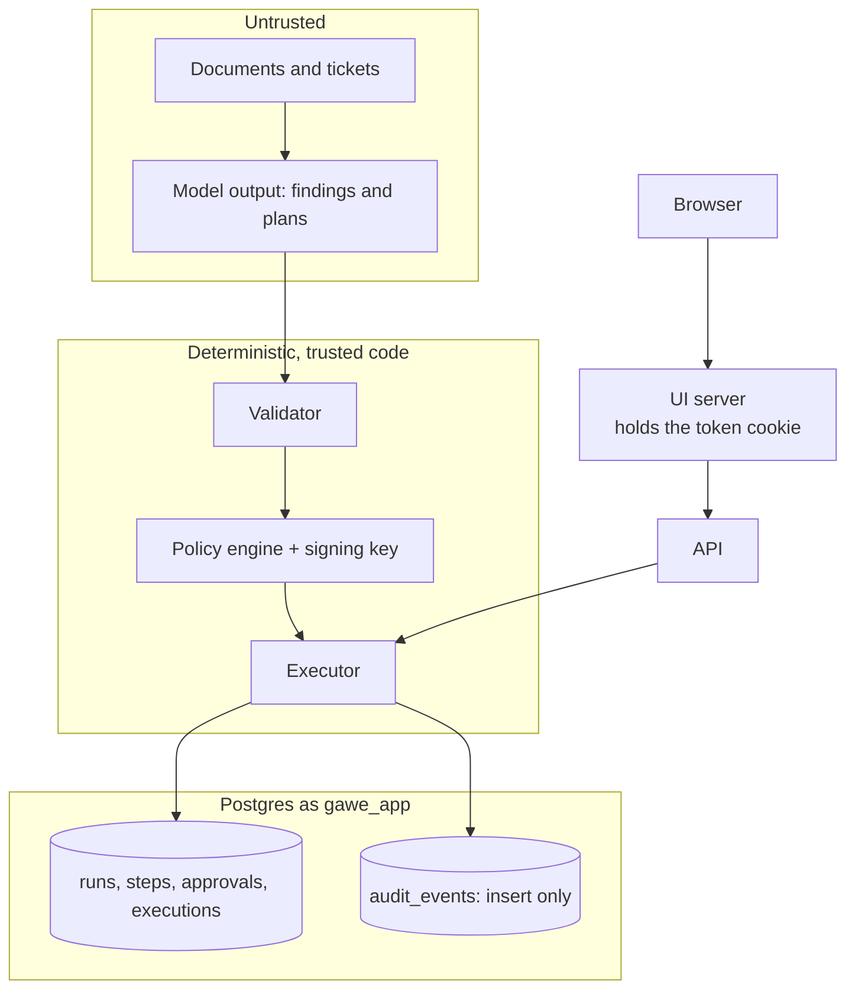

# GAWE architecture

One rule shapes everything: **the model proposes, deterministic code authorizes.** Nothing a model
says can run an action unless a separate policy engine signs that exact action, and, where policy
asks, a different person approves it.

## One run, end to end

## Components

| Component | Where | Job |
|---|---|---|
| Reader | `gawe/llm/reader.py` | Turns a document into findings with a closed schema. No tools, fenced input |
| Planner | `gawe/llm/planner.py` | Turns objective + findings into a proposed plan. Never sees document text or trusted-only tools |
| LLM provider | `gawe/llm/anthropic_provider.py`, `schema_adapt.py` | The only code that talks to a model; returns text, nothing executable |
| Validator | `gawe/core/validator.py` | Checks tools, argument schemas, dependencies and size before anything else |
| Policy engine | `gawe/core/policy/` | Evaluates YAML rules per concrete action, signs the decision (HMAC) |
| Approvals | `gawe/core/approvals.py` | Hash-bound, expiring, requester is never the approver, role-checked |
| Executor | `gawe/core/executor.py` | The only path that runs a tool: re-checks hash, signature and approval, claims the step once, retries with one idempotency key |
| Verifier | `gawe/core/verifier.py`, `gawe/core/verification.py` | Checks output protocols and read post-conditions; write success requires independent target read-back by operation key |
| Undo | `gawe/core/undo.py`, `gawe/api/undo.py` | Saves prior state before dispatch; admits person-requested reversals from armed records and recovers their durable requests (M26) |
| Orchestrator | `gawe/engine/orchestrator.py` | Drives a run: plan, then each step through policy, approval, execution, verification |
| Recovery | `gawe/engine/recovery.py` | At startup, drives unfinished runs again |
| Maintenance | `gawe/maintenance/` | Every 30 s in the API (or `sweep --once`): claims due jobs by lease, resolves read-backs read-only, continues existing plans, recovers undo requests, revokes grants at their end date, runs each tenant's next-day review at 01:00 UTC, emits heartbeats. `end-old-grants` gives grants made before M16b an end date and an expiry job (M21) |
| Audit | `gawe/core/audit.py` | Per-run hash chain; Postgres triggers enforce linkage and append-only |
| API | `gawe/api/` | Token auth, tenant checks, REST + event stream, failed-sign-in limit |
| UI | `ui/` | Next.js client; relays choices, decides nothing |
| Apps | `gawe/apps/` | Contract Review, IT access and Event Replay: tools, policies, preparation and optional Reader schemas |
| Connectors | `gawe/connectors/` | Mock systems that deduplicate on the idempotency key |
| Anchoring | `gawe/core/anchor.py`, `gawe/anchoring/` | Copies each finished run's audit head outside the database (local file, RFC 3161 signed timestamp); the verify route checks it |
| Benchmark | `bench/` (outside `gawe`) | Measures Reader accuracy on CUAD and runs prompt-injection attacks through the full engine, under a spend cap |

## Trust zones

Everything on the left of the validator is treated as hostile. The model has no credentials and no
tools; the policy signing key and the database credentials exist only in trusted processes.

## Data model (Postgres)

`runs` (status, objective, findings, signed decisions, no document once finished) with `plans`,
`steps` (per plan version, with action hash), `approvals`, `executions` (one row per attempt),
`step_outputs` (write-once), `maintenance_jobs` (durable work and read-back evidence),
`undo_records` (captured state and reversal status), and `audit_events` (hash chain per run).
Tenants, users and roles carry identity. Migrations are plain SQL in `migrations/sql/`, wrapped by Alembic, and tested with
`make test-schema`. The application connects as the limited role from migration 0004.

## Rating writes and undo (M26)

Contract Review's 3.0.0 assessment introduced one current rating and summary in the mock
contract system; 4.0.0 adds the M27 snapshots described below. Preparation reads both prior
fields and the revision together and puts them inside the action hash. The target checks that
revision, writes the new fields, moves the revision and records the operation atomically. A second write bound to the same revision fails. Assessment
versions 1.0.0 and 2.0.0 remain registered for verification of older operations, not new plans.

For an app-declared undoable tool, `VerificationResolver.prepare` inserts the undo record before
the dispatch intent. It holds the subject, prior fields, original action/key and bound revision.
Independent read-back arms it only on agreement with an observed resulting revision. Unknown,
mismatched or unobserved outcomes leave it unavailable. The store is tenant-scoped, insert-once
and compare-and-set; migration 0010 creates it, and 0011 upgrades the original S2 constraints to
support reversal states. Existing S2 deployments must apply 0011 before using reversal runs.

A case manager requests undo through the API/UI. A durable request job precedes creation of a
separate `undo` run with a trusted one-step plan. The restore manifest is trusted-only: it stays
available to the executor but is hidden from the Planner and rejected in model plans. The public
run-start route refuses that profile. Recovery can reconstruct the same run and operation key
(domain `gawe.undo.v1`, derived from the original key) without a model call.

The restore follows ordinary policy and approval, using a credential with only
`assessment:restore`. Low or no rating needs legal approval. It restores the captured fields only
while the original write's resulting revision still matches, with guard, mutation, new revision
and operation record in one target transaction. Read-back by its own key decides success. An
away-and-back edit is still a new revision and refuses the restore. A real CRM must move the
revision on every relevant mutation, including GAWE's own writes and restores, and satisfy the
same guarantee conformance cases before declaring `reversible`.

Writes and restores share rating history and its subject lock. Restoring no rating clears the
standing rating; later counted pending/unknown ratings are retained. Each undo run has its own
audit chain; `step.undo_requested` and `step.undone` or `step.undo_failed` link it from the original
run without reopening that run. Only the rating is restored: later output consumers and external
effects are not reversed.

`gawe.undo.records` observes counts per tenant on maintenance ticks: armed, used, and unavailable
by a fixed reason vocabulary (failed reversals included; unknown codes grouped as `other`).
Pending/requested records are omitted. These are histogram observations of count snapshots,
including zero buckets, not event increments to sum. They carry no rating text and do not poll
for later external changes or measure individual undo lifetimes. An armed state alone is not
proof that the contract still has the bound revision.

## Saved record evidence (M27)

Trusted preparation captures each app's declared fields and the guarded revision from the same
read. The bounded, typed snapshots live in resolved arguments, covered by the action hash:
contract `deal_value` for assessment 4.0.0 and signature 3.0.0; customer and amount for replay
2.0.0. IAM grant 3.0.0 explicitly tracks no account profile fields. Contract policy reads the
captured deal value. Other policy inputs retain their own sources; daily review reads current
state. Old tool versions, materialized steps and approvals keep their original semantics.

A target refusing a conditional write can return selected observations from the atomic guard
(`at_guard`). The executor persists proof of the refusal before closing the attempt or doing
diagnostic I/O. If guard evidence is absent, a bounded tenant-scoped read records `after_refusal`;
it cannot establish what the guard saw. Missing and unreadable targets are explicit. Partial
batch evidence stays partial, retaining unobserved targets without inventing comparisons.
Saved proof survives a crash and closes the action as not dispatched with its original
`record_changed` or `event_changed` error. Diagnostics never retry or authorize the write.

Undo records retain validated original snapshots before dispatch. Restore 2.0.0 uses those only
with confirmed original provenance: source action hash, capture time and original revision. The
restore's write guard remains the original write's resulting revision, a distinct value. Older
snapshotless records remain unavailable; nothing reconstructs history from the current target.
Unversioned historical undo requests stay pinned to restore 1.0.0. These additions use existing
JSON storage and require no SQL migration.

The API's record presenter validates saved action, target, declared-field, diagnostic and undo
bindings before exposing selected values. It never reads the target or mutates evidence. Approval
cards show the capture; refused steps show captured and observed values, timing and coverage.
The six comparison states distinguish changed, unchanged, no fields tracked, snapshot unavailable,
observation unavailable and record missing; missing fields and present null also stay distinct.
Refresh cannot substitute newer values. Matching selected fields never cancels a revision refusal:
reassessment requires a fresh run. The separate previous-approval argument comparison remains.

`python -m bench record-changes` exercises 18 fixed-plan scenarios through the shipped engine and
mock targets, including copied-view tampering and crash recovery. Literal expected records and
strict type/key/order comparison keep this control test separate from model attack measurements.
See [the M27 design and build record](m27-design.md) and [API contract](api.md).

## Rendered approval tests (M28)

`make ui-check` includes the existing Node model tests and Vitest/jsdom rendering tests. The
latter mount the real ApprovalCard and RecordEvidenceCard, inspect their DOM and exercise user
interaction. The decision action is mocked at the server boundary; React form hooks and child
components remain real. Assertions cover displayed facts and hashes, collapsed safe prose,
record-evidence states and provenance, and submitted bindings plus pending/success/error states.
These checks replace source-string inspections. They do not cover browser layout, asynchronous
server pages or the routing/session/transport boundary. See [UI testing](../ui/README.md#tests)
and [M28](m28-design.md).

## State machines

Main run/step paths (approval and verification may pause them):

Runs: `created -> planning -> running <-> paused_for_approval -> completed | failed | denied |
cancelled`. Steps: `pending -> ready -> policy_checked -> awaiting_approval -> approved ->
executing -> verifying -> succeeded`, with `failed`, `denied` and `rejected` as other ends. Only
`statemachine.py` defines legal moves, and every new transition needs a test.

Undo records: `pending -> armed | unavailable`, then `armed -> requested -> used | failed`.
Requested records can wait through normal approval and read-back. Terminal original runs stay
terminal when undo is requested.

## Why these choices

- **Own state machine, Temporal later.** The run loop is small and re-entrant (`advance` can be
  called any number of times), which makes crash recovery a loop over unfinished runs. Moving to
  Temporal replaces the driver, not the rules.
- **Two models, not one.** The model that reads hostile text has no tools and a closed output; the
  one that plans never sees that text. Compromising one does not give the other's powers.
- **Approval bound to a hash.** It is the whole defense against "approved one thing, ran another".
- **Hash chain plus database privileges plus an anchor.** Triggers and a least-privilege role stop
  casual edits; the chain makes any other edit detectable; a copy of each finished run's head
  outside the database (ideally a signed timestamp) catches truncation and rewritten history.

See [threat-model.md](threat-model.md) for attacks and their tests, and
[api.md](api.md) for the HTTP surface.
