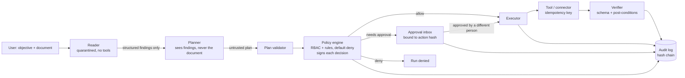
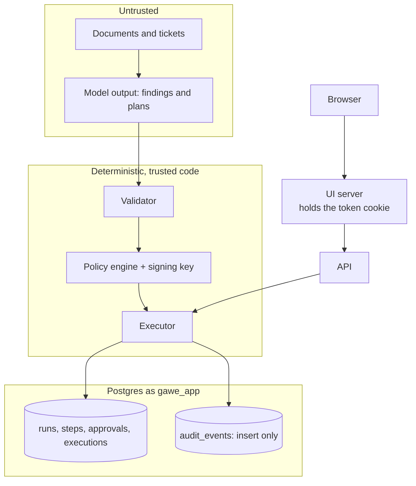

# GAWE architecture

One rule shapes everything: **the model proposes, deterministic code authorizes.** Nothing a model
says can run an action unless a separate policy engine signs that exact action, and, where policy
asks, a different person approves it.

## One run, end to end

## Components

| Component | Where | Job |
|---|---|---|
| Reader | `gawe/llm/reader.py` | Turns a document into findings with a closed schema. No tools, fenced input |
| Planner | `gawe/llm/planner.py` | Turns objective + findings into a proposed plan. Never sees document text |
| LLM provider | `gawe/llm/anthropic_provider.py`, `schema_adapt.py` | The only code that talks to a model; returns text, nothing executable |
| Validator | `gawe/core/validator.py` | Checks tools, argument schemas, dependencies and size before anything else |
| Policy engine | `gawe/core/policy/` | Evaluates YAML rules per concrete action, signs the decision (HMAC) |
| Approvals | `gawe/core/approvals.py` | Hash-bound, expiring, requester is never the approver, role-checked |
| Executor | `gawe/core/executor.py` | The only path that runs a tool: re-checks hash, signature and approval, claims the step once, retries with one idempotency key |
| Verifier | `gawe/core/verifier.py` | A step succeeds only if its output passes schema and post-conditions |
| Orchestrator | `gawe/engine/orchestrator.py` | Drives a run: plan, then each step through policy, approval, execution, verification |
| Recovery | `gawe/engine/recovery.py` | At startup, drives unfinished runs again |
| Audit | `gawe/core/audit.py` | Per-run hash chain; Postgres triggers enforce linkage and append-only |
| API | `gawe/api/` | Token auth, tenant checks, REST + event stream, failed-sign-in limit |
| UI | `ui/` | Next.js client; relays choices, decides nothing |
| Apps | `gawe/apps/` | Contract Review and IT access: tools, policies, Reader schemas |
| Connectors | `gawe/connectors/` | Mock systems that deduplicate on the idempotency key |
| Anchoring | `gawe/core/anchor.py`, `gawe/anchoring/` | Copies each finished run's audit head outside the database (local file, RFC 3161 signed timestamp); the verify route checks it |
| Benchmark | `bench/` (outside `gawe`) | Measures Reader accuracy on CUAD and runs prompt-injection attacks through the full engine, under a spend cap |

## Trust zones

Everything on the left of the validator is treated as hostile. The model has no credentials and no
tools; the policy signing key and the database credentials exist only in trusted processes.

## Data model (Postgres)

`runs` (status, objective, findings, signed decisions, no document once finished) with `plans`,
`steps` (per plan version, with action hash), `approvals`, `executions` (one row per attempt),
`step_outputs` (write-once), and `audit_events` (hash chain per run). Tenants, users and roles
carry identity. Migrations are plain SQL in `migrations/sql/`, wrapped by Alembic, and tested with
`make test-schema`. The application connects as the limited role from migration 0004.

## State machines

Runs: `created -> planning -> running <-> paused_for_approval -> completed | failed | denied |
cancelled`. Steps: `pending -> ready -> policy_checked -> awaiting_approval -> approved ->
executing -> verifying -> succeeded`, with `failed`, `denied` and `rejected` as other ends. Only
`statemachine.py` defines legal moves, and every new transition needs a test.

## Why these choices

- **Own state machine, Temporal later.** The run loop is small and re-entrant (`advance` can be
  called any number of times), which makes crash recovery a loop over unfinished runs. Moving to
  Temporal replaces the driver, not the rules.
- **Two models, not one.** The model that reads hostile text has no tools and a closed output; the
  one that plans never sees that text. Compromising one does not give the other's powers.
- **Approval bound to a hash.** It is the whole defense against "approved one thing, ran another".
- **Hash chain plus database privileges plus an anchor.** Triggers and a least-privilege role stop
  casual edits; the chain makes any other edit detectable; a copy of each finished run's head
  outside the database (ideally a signed timestamp) catches truncation and rewritten history.

See [threat-model.md](threat-model.md) for attacks and their tests, and
[api.md](api.md) for the HTTP surface.
